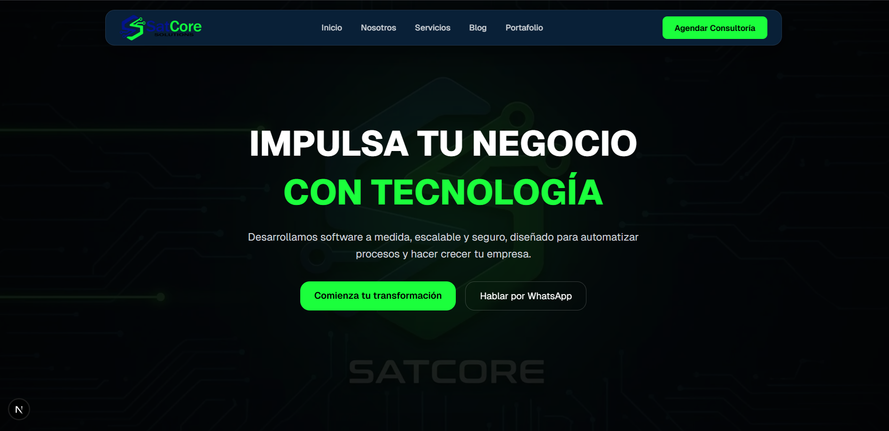
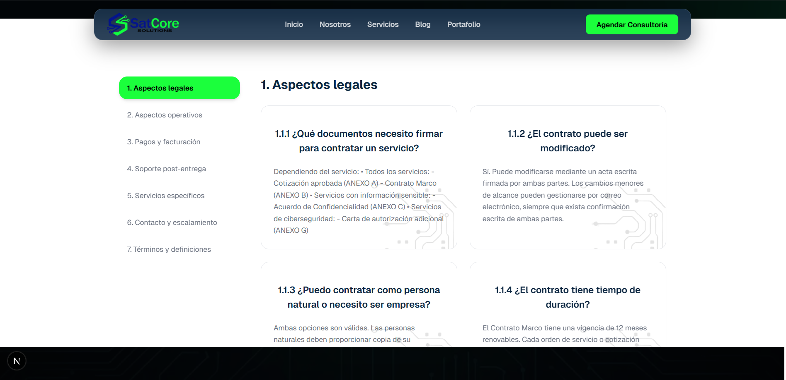
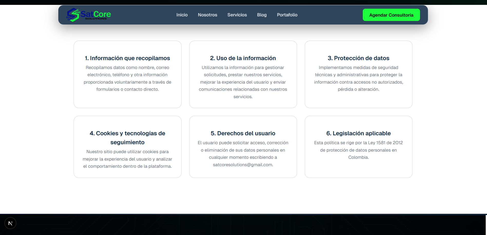

 <div align="center">


# SatCore Solutions

**SOFTWARE AND TECHNOLOGY CORE SOLUTIONS**

_Soluciones digitales seguras, accesibles y funcionales para todos._

Plataforma web corporativa enfocada en desarrollo de software, ciberseguridad, automatización e inteligencia artificial.


</div>

---

## 📌 Tabla de contenido

- [Sobre el proyecto](#-sobre-el-proyecto)
- [Identidad corporativa](#-identidad-corporativa)
- [Objetivos](#-objetivos)
- [Características principales](#-características-principales)
- [Stack tecnológico](#️-stack-tecnológico)
- [Requisitos](#-requisitos)
- [Instalación](#-instalación)
- [Configuración](#️-configuración)
- [Desarrollo](#️-desarrollo)
- [Estructura del proyecto](#-estructura-del-proyecto)
- [Arquitectura](#-arquitectura)
- [Sistema de diseño](#-sistema-de-diseño)
- [SEO y rendimiento](#-seo-y-rendimiento)
- [Privacidad y tratamiento de datos](#-privacidad-y-tratamiento-de-datos)
- [Seguridad](#-seguridad)
- [Capturas de pantalla](#-capturas-de-pantalla)
- [Pruebas y calidad](#-pruebas-y-calidad)
- [Despliegue](#-despliegue)
- [Contribuciones y proyectos derivados](#-contribuciones-y-proyectos-derivados)
- [Atribución](#-atribución)
- [Marca y propiedad intelectual](#-marca-y-propiedad-intelectual)
- [Dependencias de terceros](#-dependencias-de-terceros)
- [Estado y versión](#-estado-y-versión)
- [Roadmap](#-roadmap)
- [Licencia](#-licencia)
- [Contacto y autoría](#-contacto-y-autoría)

---

## 🧠 Sobre el proyecto

**SatCore Solutions** es la plataforma web corporativa oficial de SatCore Solutions, desarrollada para presentar la identidad de la organización, sus capacidades tecnológicas y sus servicios profesionales.

El proyecto busca consolidar una presencia digital moderna, coherente y escalable, con una experiencia de usuario adaptable a distintos dispositivos y una arquitectura que permita ampliar progresivamente las funcionalidades de la plataforma.

La propuesta se centra en cuatro áreas principales:

- **Desarrollo de software:** diseño y construcción de soluciones digitales a medida.
- **Ciberseguridad:** protección de sistemas, aplicaciones y activos digitales.
- **Automatización:** optimización de procesos mediante herramientas tecnológicas.
- **Inteligencia artificial:** exploración e integración de capacidades inteligentes en productos y servicios digitales.

La plataforma incorpora una interfaz modular, páginas informativas, contenido estructurado y una base preparada para futuras integraciones con servicios externos.

## 🏢 Identidad corporativa

SatCore Solutions se presenta como una iniciativa tecnológica orientada a construir soluciones digitales funcionales, mantenibles y seguras.

### SOFTWARE AND TECHNOLOGY CORE SOLUTIONS

**Propósito:** desarrollar y promover soluciones tecnológicas que respondan a necesidades reales mediante ingeniería de software, automatización, seguridad e innovación.

### Áreas de trabajo

- **Desarrollo:** creación y mantenimiento de aplicaciones y plataformas digitales.
- **Automatización:** optimización de flujos de trabajo y procesos.
- **Seguridad:** incorporación de prácticas de desarrollo seguro y protección de activos digitales.
- **Estudio e investigación:** exploración de tecnologías, metodologías y nuevas soluciones.
- **Marketing tecnológico:** comunicación de servicios, productos e identidad digital.

### Principios de desarrollo

- Arquitectura modular y escalable.
- Código organizado y tipado.
- Experiencia de usuario consistente.
- Diseño adaptable y accesible.
- Protección de la información.
- Evolución controlada del producto.

---

## 🎯 Objetivos

1. Fortalecer la presencia digital y la identidad corporativa de SatCore Solutions.
2. Comunicar de manera clara los servicios y las capacidades de la organización.
3. Facilitar el contacto con clientes y personas interesadas en los servicios.
4. Proporcionar una experiencia rápida, intuitiva y adaptable a diferentes dispositivos.
5. Mantener una arquitectura preparada para futuras integraciones.
6. Incorporar progresivamente herramientas de analítica, automatización e inteligencia artificial.

---

## ✨ Características principales

### Interfaz y experiencia de usuario

- Diseño visual moderno alineado con la identidad de marca.
- Componentes reutilizables y estructura modular.
- Diseño responsive con enfoque _mobile-first_.
- Sistema de estilos centralizado.
- Animaciones e interacciones de interfaz mediante las herramientas incorporadas al proyecto.

### Contenido corporativo

- Página principal o _landing page_.
- Secciones informativas organizadas por componentes.
- Preguntas frecuentes (FAQ) mediante contenido estructurado.
- Páginas legales de privacidad y términos.
- Base preparada para ampliar la información institucional y comercial.

### Preparación para futuras funcionalidades

- Integración de formularios de contacto con servicios de correo.
- Conexión con API y servicios de backend.
- Analítica y medición del comportamiento de la plataforma.
- Posibles herramientas para clientes.
- Integraciones futuras con inteligencia artificial y automatización.

> Las funcionalidades descritas como futuras o en desarrollo no deben considerarse disponibles en producción hasta que su implementación y funcionamiento hayan sido verificados.

---

## ⚙️ Stack tecnológico

| Tecnología      | Función                                                                                    |
| --------------- | ------------------------------------------------------------------------------------------ |
| Next.js 16      | Framework principal y estructura de la aplicación                                          |
| React 19        | Construcción de interfaces mediante componentes                                            |
| TypeScript      | Tipado estático y mantenibilidad del código                                                |
| Tailwind CSS v4 | Estilización y diseño responsive                                                           |
| Framer Motion   | Animaciones e interacciones, cuando corresponda                                            |
| Lucide Icons    | Iconografía de interfaz                                                                    |
| Resend          | Integración de correo electrónico prevista o utilizada según la configuración del proyecto |
| CSS Variables   | Tokens de diseño y personalización visual                                                  |

La selección definitiva de versiones y dependencias debe mantenerse sincronizada con `package.json` y el archivo de bloqueo del gestor de paquetes utilizado.

### Herramientas y convenciones

- Componentes reutilizables.
- Estilos globales y utilidades compartidas.
- Organización por responsabilidades.
- Contenido separado de su presentación cuando corresponda.
- Configuración de metadatos para buscadores y redes sociales.

---

## 💻 Requisitos

Antes de instalar el proyecto, verifica que tu entorno incluya:

- Node.js compatible con la versión de Next.js utilizada.
- npm, o el gestor de paquetes definido por el repositorio.
- Git para clonar y controlar versiones.
- Un editor compatible con TypeScript, como Visual Studio Code.

Para comprobar las herramientas instaladas:

```bash
node --version
npm --version
git --version
```

Se recomienda utilizar una versión LTS de Node.js compatible con las dependencias reales del proyecto.

---

## 🚀 Instalación

### 1. Clonar el repositorio

Reemplaza `<URL_DEL_REPOSITORIO>` por la dirección real del repositorio autorizado.

```bash
git clone <URL_DEL_REPOSITORIO>
cd site_corporative
```

### 2. Instalar dependencias

```bash
npm install
```

### 3. Iniciar el servidor de desarrollo

```bash
npm run dev
```

Abre la siguiente dirección en el navegador:

```text
http://localhost:3000
```

### 4. Preparar una compilación de producción

```bash
npm run build
npm run start
```

El comando `npm run start` debe ejecutarse después de una compilación exitosa.

---

## ⚙️ Configuración

La configuración de la aplicación debe gestionarse mediante los archivos del proyecto y variables de entorno cuando se requieran credenciales o servicios externos.

### Variables de entorno

Si la integración de correo, analítica u otros servicios necesita credenciales, deben configurarse mediante un archivo `.env.local` en el entorno de desarrollo.

Ejemplo orientativo:

```dotenv
# Ejemplo: configurar únicamente si la integración está implementada
RESEND_API_KEY=
```

**Importante:**

- No incluyas claves reales en el README.
- No subas archivos con secretos al repositorio.
- Mantén `.env.local` fuera del control de versiones.
- Configura las variables requeridas también en el proveedor de despliegue.
- Verifica cuáles variables utiliza realmente el código antes de añadirlas a la configuración definitiva.

Si el proyecto no utiliza actualmente variables de entorno, no es necesario crear configuraciones ficticias.

---

## 🛠️ Desarrollo

Para trabajar localmente:

```bash
npm run dev
```

Antes de enviar cambios, comprueba los scripts disponibles en `package.json`. Si están configurados, utiliza los comandos correspondientes para validar el proyecto:

```bash
npm run lint
npm run type-check
npm run build
```

No todos estos scripts necesariamente existen en todas las versiones del proyecto; deben ejecutarse únicamente si están definidos.

### Convenciones recomendadas

- Utilizar TypeScript en los componentes y módulos que lo requieran.
- Mantener los componentes pequeños y con responsabilidades claras.
- Reutilizar componentes compartidos antes de duplicar código.
- Centralizar los estilos y tokens de diseño.
- Evitar almacenar credenciales en el código fuente.
- Documentar los cambios que afecten la arquitectura o la configuración.
- Verificar las páginas principales después de modificar componentes compartidos.

---

## 📁 Estructura del proyecto

La estructura siguiente representa una organización de referencia para la plataforma. Debe ajustarse a los directorios existentes en el repositorio.

```text
site_corporative/
├── public/
│   ├── logos/
│   │   └── 01_Logo_Principal.png
│   └── screenshots/
│       ├── home.png
│       ├── faq.png
│       └── privacy.png
├── src/
│   ├── app/
│   │   ├── layout.tsx
│   │   └── page.tsx
│   ├── components/
│   │   ├── ui/
│   │   ├── sections/
│   │   └── shared/
│   ├── data/
│   ├── lib/
│   ├── hooks/
│   ├── styles/
│   │   ├── globals.css
│   │   ├── themes/
│   │   ├── tokens/
│   │   └── utilities/
│   └── types/
├── .env.example
├── .gitignore
├── package.json
├── package-lock.json
├── next.config.ts
├── tsconfig.json
└── README.md
```

**Nota:** los archivos y directorios mostrados son orientativos. No deben crearse carpetas vacías ni reorganizarse rutas existentes únicamente para hacer coincidir el repositorio con este ejemplo.

### Responsabilidad de los directorios

| Directorio                 | Responsabilidad                                  |
| -------------------------- | ------------------------------------------------ |
| `public/`                  | Recursos estáticos, logotipos e imágenes         |
| `src/app/`                 | Rutas, páginas y layouts de Next.js              |
| `src/components/ui/`       | Componentes visuales reutilizables               |
| `src/components/sections/` | Secciones de las páginas                         |
| `src/components/shared/`   | Componentes compartidos entre distintas áreas    |
| `src/data/`                | Contenido estructurado utilizado por la interfaz |
| `src/lib/`                 | Utilidades y lógica común                        |
| `src/hooks/`               | Hooks personalizados de React                    |
| `src/styles/`              | Estilos globales, tokens y temas                 |
| `src/types/`               | Tipos e interfaces compartidos                   |

---

## 🧱 Arquitectura

La plataforma sigue un enfoque basado en componentes, con separación de responsabilidades y una organización pensada para facilitar el mantenimiento.

### Principios arquitectónicos

- **Component-based:** construcción de interfaces mediante componentes reutilizables.
- **Data-driven:** separación entre contenido y presentación cuando resulta conveniente.
- **Modularidad:** organización de las secciones para facilitar su evolución.
- **Tipado:** uso de TypeScript para mejorar la detección de errores.
- **Consistencia visual:** utilización de tokens y estilos compartidos.
- **Escalabilidad:** posibilidad de incorporar nuevas páginas e integraciones sin rehacer toda la estructura.

Next.js proporciona la infraestructura de rutas y renderizado de la aplicación. React permite construir la interfaz, mientras que TypeScript aporta controles estáticos sobre los datos y componentes.

Las decisiones específicas de renderizado, uso de componentes de servidor o cliente y estrategia de caché deben documentarse conforme a la implementación real.

---

## 🎨 Sistema de diseño

La identidad visual se apoya en una paleta reducida, con predominio de tonos neutros, azul como color institucional y verde para acciones destacadas.

### Paleta de colores

| Color              | Código    | Uso previsto                                   |
| ------------------ | --------- | ---------------------------------------------- |
| Azul institucional | `#132A8E` | Identidad, encabezados y elementos principales |
| Verde de acento    | `#1BFF3C` | Llamadas a la acción y elementos destacados    |
| Negro              | `#0A0A0A` | Fondos oscuros y contraste                     |
| Gris claro         | `#F6F9FC` | Fondos claros y superficies                    |

### Distribución visual de referencia

- **70 %:** colores neutros.
- **20 %:** azul institucional.
- **10 %:** verde de acento.

Esta distribución es una guía visual, no una proporción calculada automáticamente.

### Criterios de diseño

- Mantener un contraste suficiente entre texto y fondo.
- Aplicar estilos consistentes entre las páginas.
- Adaptar la distribución a pantallas móviles, tabletas y escritorio.
- Evitar animaciones que dificulten la navegación.
- Respetar las preferencias de movimiento reducido cuando corresponda.
- Centralizar colores y valores reutilizables en tokens o variables CSS.

---

## 🔎 SEO y rendimiento

La plataforma contempla la configuración de metadatos y una estructura semántica que favorezca su indexación y presentación en buscadores y redes sociales.

### SEO

- Metadatos por página.
- Títulos y descripciones coherentes con el contenido.
- Configuración de Open Graph y tarjetas de Twitter/X, según la implementación.
- HTML semántico.
- Configuración de indexación mediante metadatos y directivas cuando corresponda.
- Optimización de títulos, encabezados e imágenes.

### Métricas objetivo

| Indicador                      | Objetivo                                           |
| ------------------------------ | -------------------------------------------------- |
| Lighthouse Performance         | Más de 90 como meta                                |
| Largest Contentful Paint (LCP) | Menos de 2,5 segundos                              |
| Diseño responsive              | Experiencia adaptable en dispositivos              |
| Accesibilidad                  | Utilizar WCAG 2.1 AA como referencia de evaluación |
| Seguridad de transporte        | HTTPS en producción                                |

Estos valores son **objetivos de calidad**, no resultados certificados. Para afirmar que se cumplen, es necesario ejecutar pruebas sobre la versión desplegada y registrar sus resultados.

---

## 🔐 Privacidad y tratamiento de datos

La plataforma debe aplicar criterios de minimización de datos, transparencia y tratamiento responsable de la información.

### Principios

- Recopilar únicamente los datos necesarios para una finalidad definida.
- Informar a los usuarios sobre el tratamiento de sus datos.
- Mantener accesibles las páginas de privacidad y términos cuando corresponda.
- Limitar el acceso a información sensible.
- Evitar incluir datos personales o secretos en los registros de depuración.
- Revisar las integraciones de terceros antes de habilitarlas en producción.

### Formularios y servicios externos

Si se implementan formularios de contacto o integraciones de correo, deben verificarse:

- Qué información se recopila.
- A qué servicio se transmite.
- Cuánto tiempo se conserva.
- Quién puede acceder a ella.
- Qué controles se aplican para prevenir abuso y envíos automatizados.

La existencia de páginas legales en la interfaz no garantiza por sí sola el cumplimiento normativo. Los textos y procesos deben corresponder al funcionamiento real del sitio y a la normativa aplicable.

---

## 🛡️ Seguridad

La seguridad debe formar parte del desarrollo, la configuración y el despliegue de la plataforma.

### Medidas recomendadas

- Mantener Next.js, React y las dependencias actualizadas.
- Revisar las vulnerabilidades reportadas por las herramientas de auditoría.
- Mantener secretos y claves fuera del código fuente.
- Validar los datos recibidos por formularios y API.
- Aplicar controles contra envíos abusivos cuando existan formularios públicos.
- Configurar HTTPS en producción.
- Evaluar encabezados de seguridad HTTP según las necesidades de la aplicación.
- Restringir el acceso a servicios administrativos y credenciales.
- Revisar los permisos de los servicios externos conectados.

### Verificaciones antes de producción

- Confirmar que no se exponen claves en el navegador.
- Comprobar que las rutas sensibles no quedan accesibles sin autorización.
- Revisar el manejo de errores y mensajes de depuración.
- Verificar las configuraciones del proveedor de despliegue.
- Evaluar las dependencias con las herramientas disponibles.

No debe afirmarse que existen encabezados de seguridad, autenticación u otros controles específicos hasta verificar su configuración efectiva.

---

## 🖼️ Capturas de pantalla

Las capturas permiten documentar la apariencia de las principales áreas de la plataforma.

### Página principal



### Preguntas frecuentes



### Privacidad y términos



> Las imágenes deben existir en `public/screenshots/` para que se visualicen en el repositorio. Sustituye las capturas por imágenes actualizadas cuando cambie la interfaz.

---

## 🧪 Pruebas y calidad

La calidad del proyecto debe verificarse antes de integrar cambios o desplegar una nueva versión.

### Validaciones recomendadas

- Compilación de producción.
- Comprobación de tipos de TypeScript.
- Análisis estático y linting.
- Pruebas de navegación entre páginas.
- Verificación de enlaces e imágenes.
- Revisión responsive en diferentes resoluciones.
- Pruebas de accesibilidad.
- Evaluación de rendimiento mediante Lighthouse.
- Verificación de formularios e integraciones externas, cuando estén habilitados.

### Comandos de referencia

```bash
npm run lint
npm run type-check
npm run build
```

Estos comandos dependen de los scripts configurados en `package.json`. Si alguno no existe, debe configurarse o sustituirse por el comando definido en el proyecto.

---

## 🚀 Despliegue

Vercel es una opción recomendada para desplegar aplicaciones Next.js, siempre que se ajuste a los requisitos del proyecto.

### Preparación

1. Confirmar que la aplicación compila correctamente.
2. Configurar las variables de entorno requeridas.
3. Revisar las rutas y los recursos estáticos.
4. Configurar el dominio y HTTPS.
5. Verificar los metadatos y la configuración de indexación.
6. Ejecutar pruebas funcionales después del despliegue.

### Compilación local

```bash
npm run build
```

### Inicio de producción local

```bash
npm run start
```

La configuración de producción debe gestionarse desde el proveedor de despliegue y los archivos de configuración del repositorio. No se deben publicar credenciales ni datos de acceso.

---

## 🤝 Contribuciones y proyectos derivados

Actualmente, el proyecto es privado y está gestionado por SatCore Solutions.

Las contribuciones deben contar con autorización del equipo responsable y seguir los criterios internos de calidad, seguridad y propiedad intelectual.

### Flujo de trabajo recomendado

1. Crear una rama para el cambio.
2. Mantener el alcance de la modificación claramente definido.
3. Verificar los tipos y las reglas de linting disponibles.
4. Ejecutar la compilación de producción.
5. Revisar el comportamiento responsive.
6. Documentar cambios relevantes.
7. Solicitar revisión antes de integrar los cambios.

### Proyectos derivados

No se autoriza asumir que el código, los componentes, los recursos gráficos o la identidad visual pueden reutilizarse en proyectos externos. Cualquier derivación, redistribución o reutilización debe ajustarse a la licencia aplicable y contar con las autorizaciones necesarias.

---

## 🧾 Atribución

La identidad visual, el diseño, la estructura documental y los componentes propios del proyecto deben atribuirse a SatCore Solutions cuando corresponda y de acuerdo con los términos de la licencia aplicable.

Las tecnologías y dependencias de terceros conservan sus respectivas autorías y condiciones de uso.

La inclusión de una biblioteca en el proyecto no implica que SatCore Solutions sea titular de dicha biblioteca.

---

## ™️ Marca y propiedad intelectual

**SatCore Solutions** y sus elementos identificativos forman parte de la identidad corporativa de la organización.

Salvo autorización expresa o disposición legal aplicable, no se concede mediante este README permiso para:

- Utilizar la marca con fines comerciales ajenos al proyecto.
- Presentar productos o servicios de terceros como oficiales de SatCore Solutions.
- Redistribuir recursos gráficos propios de la organización.
- Reutilizar el código propietario fuera de los términos autorizados.
- Crear materiales que sugieran una afiliación o aprobación inexistente.

Los derechos sobre componentes, código, imágenes, logotipos y otros recursos deben interpretarse de acuerdo con su titularidad y las licencias correspondientes.

---

## 📦 Dependencias de terceros

El proyecto utiliza tecnologías y bibliotecas de terceros para proporcionar su infraestructura, interfaz y posibles integraciones.

Entre ellas se encuentran las tecnologías indicadas en el stack, como Next.js, React, TypeScript, Tailwind CSS, Framer Motion, Lucide y, si está habilitado, Resend.

Cada dependencia conserva sus propios términos de licencia y condiciones de uso.

### Buenas prácticas

- Revisar las licencias antes de incorporar nuevas dependencias.
- Mantener el archivo de bloqueo del gestor de paquetes.
- Evitar dependencias innecesarias o abandonadas.
- Revisar las vulnerabilidades conocidas.
- Documentar integraciones que procesen información de usuarios.
- Consultar la documentación oficial de cada proveedor.

---

## 📊 Estado y versión

| Campo                             | Valor                                         |
| --------------------------------- | --------------------------------------------- |
| Proyecto                          | SatCore Solutions                             |
| Tipo                              | Plataforma web corporativa                    |
| Estado general                    | Activo                                        |
| Framework principal               | Next.js 16, según la información del proyecto |
| Interfaz                          | React 19                                      |
| Lenguaje                          | TypeScript                                    |
| Estilos                           | Tailwind CSS v4                               |
| Repositorio                       | Privado                                       |
| Versión publicada                 | Por confirmar en el repositorio               |
| Fecha de actualización documental | 21 de octubre de 2026                         |

La fecha documental no representa necesariamente la fecha de lanzamiento de una versión. La versión oficial debe sincronizarse con el sistema de versionado del proyecto.

---

## 🗺️ Roadmap

El siguiente roadmap recoge las fases compartidas para la evolución de la plataforma. Los estados deben actualizarse según el avance real del desarrollo.

### Fase 1 — Base corporativa

- [x] Página principal.
- [x] Estructura modular de secciones.
- [x] Sistema dinámico de preguntas frecuentes.
- [x] Páginas de términos y privacidad.

### Fase 2 — Integraciones y medición

- [ ] Integración de backend y API.
- [ ] Formulario de contacto integrado con Resend.
- [ ] Analítica y seguimiento de uso.
- [ ] Validación de los controles de seguridad y privacidad asociados.

### Fase 3 — Expansión de capacidades

- [ ] Dashboard para clientes.
- [ ] Integración de inteligencia artificial.
- [ ] Automatización de procesos.
- [ ] CMS interno para administrar contenidos.

> Las casillas marcadas como completadas reflejan el estado declarado en la información inicial del proyecto. Las demás representan trabajo previsto y no implican fechas de entrega comprometidas.

---

## 📄 Licencia

Este proyecto es privado y su utilización está sujeta a las condiciones de propiedad intelectual y licenciamiento establecidas por SatCore Solutions.

**Licencia corporativa de referencia: SCSAL 1.0.**

Antes de distribuir el repositorio, confirma que el archivo `LICENSE` incluya el texto oficial de SCSAL 1.0 y que esa licencia sea la asignada expresamente a este proyecto. Si no existe dicho archivo o la licencia aún no está confirmada, no debe presentarse como una concesión legal definitiva.

Salvo autorización expresa, no se permite asumir que la publicación de este README concede derechos para copiar, modificar, redistribuir o comercializar el software.

© SatCore Solutions. Todos los derechos reservados, en la medida aplicable conforme a la titularidad y las licencias correspondientes.

---

## 📞 Contacto y autoría

**SatCore Solutions**

_SOFTWARE AND TECHNOLOGY CORE SOLUTIONS_

- Correo electrónico: [satcoresolutions@gmail.com](mailto:satcoresolutions@gmail.com)
- Teléfono: +57 302 201 6072
- Sitio web: dirección oficial pendiente de confirmar.
- Repositorio: privado, administrado por SatCore Solutions.

Para consultas sobre el proyecto, sus integraciones o posibles colaboraciones, utiliza los canales de contacto oficiales.

---

<div align="center">

**Hecho con 💚 por SatCore Solutions**

_Soluciones digitales seguras, accesibles y funcionales para todos._

© SatCore Solutions — Todos los derechos reservados.

</div>
